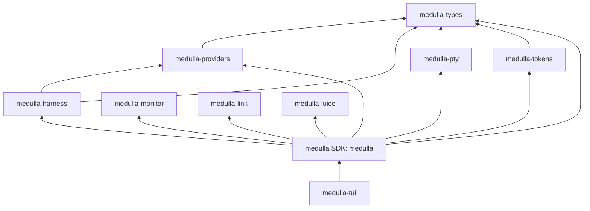

# Architecture

This page is about the code: how the crates are put together, where a session lives, and how a remote host is reached. [One terminal, not a pile of them](../why-one-terminal.md) is the product argument.

## Crates and dependency direction

The [Cargo](https://doc.rust-lang.org/cargo/) workspace is one product assembled from small primitives. Each crate can be read and tested on its own; the SDK composes them, and the terminal app presents them. Arrows below point from a crate to the crates it depends on:

More precisely, `medulla-providers` depends on `medulla-types`; `medulla-harness` depends on `medulla-types` and `medulla-providers`; and `medulla-pty` and `medulla-tokens` depend on `medulla-types`. `medulla-monitor`, `medulla-link`, and `medulla-juice` are standalone primitives. The `medulla` SDK composes these crates, and `medulla-tui` depends on the SDK and the primitives it uses directly. Primitive crates do not depend on `medulla` or `medulla-tui`; only `medulla-tui` owns terminal rendering and input.

| Crate | Product primitive and responsibility |
| --- | --- |
| [`crates/medulla-types/`](https://github.com/tinyhumansai/medulla/tree/main/crates/medulla-types/) (`medulla-types`) | Shared value types used across primitive boundaries. |
| [`crates/medulla-providers/`](https://github.com/tinyhumansai/medulla/tree/main/crates/medulla-providers/) (`medulla-providers`) | Provider registry and invocation shaping for harnesses and model routes. |
| [`crates/medulla-harness/`](https://github.com/tinyhumansai/medulla/tree/main/crates/medulla-harness/) (`medulla-harness`) | Harness customization, launch configuration, and attribution helpers. |
| [`crates/medulla-monitor/`](https://github.com/tinyhumansai/medulla/tree/main/crates/medulla-monitor/) (`medulla-monitor`) | Host resource monitoring primitives. |
| [`crates/medulla-link/`](https://github.com/tinyhumansai/medulla/tree/main/crates/medulla-link/) (`medulla-link`) | Host link transport for remote sessions. |
| [`crates/medulla-juice/`](https://github.com/tinyhumansai/medulla/tree/main/crates/medulla-juice/) (`medulla-juice`) | Pluggable context compression primitives. |
| [`crates/medulla-pty/`](https://github.com/tinyhumansai/medulla/tree/main/crates/medulla-pty/) (`medulla-pty`) | PTY screen model, codec, and terminal conversion primitives. |
| [`crates/medulla-tokens/`](https://github.com/tinyhumansai/medulla/tree/main/crates/medulla-tokens/) (`medulla-tokens`) | Token accounting and subscription meters. |
| [`crates/medulla-core/`](https://github.com/tinyhumansai/medulla/tree/main/crates/medulla-core/) (`medulla`) | SDK composition: account and backend clients, daemon, session and workflow logic, and integration state. It is reusable without the TUI. |
| [`crates/medulla-tui/`](https://github.com/tinyhumansai/medulla/tree/main/crates/medulla-tui/) (`medulla-tui`) | The `medulla` binary: terminal UI, CLI dispatch, PTY process wiring, and remote client/server. |

The SDK never depends on the TUI. The lower-level primitives remain reusable without pulling in the application or its terminal UI dependencies.

## A session is a PTY

The centre of the app crate is [`worker/pty/`](https://github.com/tinyhumansai/medulla/tree/main/crates/medulla-tui/src/worker/pty/). A session is a real `claude`, `codex`, `opencode`, `openhuman`, or shell process spawned on a pseudo-terminal in its interactive mode, with its output parsed by a `vt100` terminal emulator into a screen grid the TUI can draw. This is the counterpart to the SDK's headless path, not a replacement: `-p --output-format stream-json` suppresses the interface to extract events, and here the interface is the point.

The module splits by responsibility:

* `launch` builds the interactive argv per provider (`opencode tui`, the bypass flag when asked for, `--model` versus `-m`) and attaches the MCP socket and grant.
* `inject` is the timing and mode choreography that gets a prompt accepted by a full-screen CLI.
* `dialog` recognises a harness blocked on a startup dialog.
* `attention` recognises a harness blocked on a person, which is what makes a row pulse. See [Attention cues](../features/attention.md).
* `handle` is `SessionHandle`, one session's own state and locks; `manager` is `PtyManager`, the read-mostly registry of handles. The split is what lets a reader thread stamping a timestamp, a render pass reading a screen, and a write into a wedged child stop contending on one lock.

Scrollback is 2,000 lines per session. Background sessions keep parsing, so switching rows is a lookup rather than a catch-up.

The TUI's keyboard is modal: `HarnessFocus` is either `Chrome` or `Attached(session)`, shown in the pane title, and while attached every key except the focus chord is encoded and written to the PTY.

## Remote hosts

[`remote/`](https://github.com/tinyhumansai/medulla/tree/main/crates/medulla-tui/src/remote/) has two halves.

`remote/client/` runs on the machine you are looking at. `bootstrap.rs` shells out to the operator's own `ssh` (there is no SSH crate in the workspace, on purpose: host-key trust, agent forwarding, `~/.ssh/config`, `ProxyJump`, and hardware keys are the operator's `ssh`'s job, and reimplementing trust-on-first-use inside a modal would be a security surface owned forever; mosh made the same call). It runs `medulla daemon --direct --peer-node <our id>` on the far side and waits up to thirty seconds for one connect line on stdout. `exec.rs` is `medulla remote --exec`, the smallest thing that exercises the whole chain.

`remote/serve/` is what runs on the far side. `entry.rs` is `medulla daemon --direct`: it mints a pair key for the one client named by `--peer-node`, binds UDP, prints the connect line, closes its stdio so the SSH channel can end, and serves sessions from that machine's own config. `sessions.rs` holds the PTYs it serves, using the same `PtyManager` as the local app.

After the bootstrap the two ends talk through `medulla-link` directly. The client keeps a cache per host ([`ui/app/remote_hosts.rs`](https://github.com/tinyhumansai/medulla/tree/main/crates/medulla-tui/src/ui/app/remote_hosts.rs)): status, capabilities, session rows, and the one screen currently streaming. It is a cache and not a connection because bootstrapping means running `ssh` and waiting, and the render pass must never wait for anything.

## The host link

[`medulla-link`](https://github.com/tinyhumansai/medulla/tree/main/crates/medulla-link/) is not a byte stream. A datagram carries "here is how to get from state *m* to state *n*", and the receiver applies it only when it holds state *m*. Applying the same instruction twice is a no-op and a stale one is refused, so loss, reordering, and duplication need no special handling, and a peer that was away for a minute gets one diff to current rather than a minute of backlog. There is no connection to break: a link that stops working resumes when datagrams flow again, with no reconnect and no handshake.

Two channels ride it. Channel 1 is a latest-wins screen grid, one per peer, which is why one remote session streams at a time. Channel 0 is an append-only message queue for control and presence, which is how every remote session's row stays current whether or not its screen is showing.

The payload is ChaCha20-Poly1305 under a 128-bit pair key only the two endpoints hold, and the cleartext header in front of it is authenticated under a path key both ends derive from that same pair key. Datagrams go straight from one machine to the other; there is no relay and no backend in the path. The full specification is [Host link protocol](host-link-protocol.md).

## The SDK

The modules a session touches:

* [`config/`](https://github.com/tinyhumansai/medulla/tree/main/crates/medulla-core/src/config/): the layered load, every section's types, and the rule that `[[remoteHosts]]` and `[[hooks]]` are only read from the global file.
* [`daemon/providers/`](https://github.com/tinyhumansai/medulla/tree/main/crates/medulla-core/src/daemon/providers/): `PATH` detection of the coding CLIs and their headless execution paths, including the shared-process Codex app-server transport and the ACP client.
* [`harness_hooks/`](https://github.com/tinyhumansai/medulla/tree/main/crates/medulla-core/src/harness_hooks/): the lifecycle hooks Medulla installs into a launched harness, and the `medulla hook` shim they call back through.
* [`inference_proxy/`](https://github.com/tinyhumansai/medulla/tree/main/crates/medulla-core/src/inference_proxy/): the loopback proxy behind custom presets and `[router]`. See [Attribution and routing](attribution-and-routing.md).
* [`clipboard/`](https://github.com/tinyhumansai/medulla/tree/main/crates/medulla-core/src/clipboard/): writers for tmux's buffer, the platform binaries, and OSC 52, with the nested-tmux passthrough.
* [`session_history/`](https://github.com/tinyhumansai/medulla/tree/main/crates/medulla-core/src/session_history/): reads the CLIs' own transcript directories for `medulla sessions` and resume.
* [`auth/`](https://github.com/tinyhumansai/medulla/tree/main/crates/medulla-core/src/auth/), [`client/`](https://github.com/tinyhumansai/medulla/tree/main/crates/medulla-core/src/client/), and [`access/`](https://github.com/tinyhumansai/medulla/tree/main/crates/medulla-core/src/access/): sign-in, the typed HTTP surface over the shared `tinyhumans-sdk` transport, and the plan-entitlement verdict read from `/auth/me`. See [Authentication](authentication.md).
* [`update/`](https://github.com/tinyhumansai/medulla/tree/main/crates/medulla-core/src/update/): the release check and self-update.
* [`workflows/`](https://github.com/tinyhumansai/medulla/tree/main/crates/medulla-core/src/workflows/), [`flow_engine/`](https://github.com/tinyhumansai/medulla/tree/main/crates/medulla-core/src/flow_engine/), and [`mcp/`](https://github.com/tinyhumansai/medulla/tree/main/crates/medulla-core/src/mcp/): saved graphs, the adapter seam onto the vendored `tinyflows` engine, and the tool server offered to every launched harness. All behind the default `workflows` feature.

[`backend/`](https://github.com/tinyhumansai/medulla/tree/main/crates/medulla-core/src/backend/) holds the `Backend` trait the UI's account-facing parts drive: account usage, sign-out, and the feedback board, and nothing else. `CloudBackend` is the signed-in case, `MockBackend` backs `--mock` and the test suites, and `OfflineBackend` is what a signed-out run holds. It is what makes the whole app runnable offline. The backend is never in the path of a session: it is asked whether this account may run Medulla, and after that everything is local.

Dispatch, when a workflow step or an MCP `fleet_*` call asks for work to be run rather than a person opening a session, goes through [`hub/`](https://github.com/tinyhumansai/medulla/tree/main/crates/medulla-core/src/hub/): a device-local router with a worker roster, a `TaskRunner`, and an activity log, dispatching over the in-process bus to the agents on this machine. `bridge/`, `harness_contract/`, `agent/`, and `sessions/` are the pieces it is built on; `wrapper/` is the transparent harness wrapper behind `medulla claude`, `medulla codex`, and `medulla opencode`.

## Testing philosophy

Because the UI depends on the `Backend` trait rather than a live account API, and a session is a process on a PTY, the whole system can be exercised offline. Unit tests live in a module's sibling `tests.rs`; cross-module suites live in the owning crate's `tests/` directory. The remote-host end-to-end suite runs `medulla remote --exec` between two containers. See [Testing](testing.md).

## Read next

* [Host link protocol](host-link-protocol.md): the wire, normatively.
* [Harness integration](harness-integration.md): how each CLI is launched and driven.
* [CLI Reference](cli-reference.md): the daemon and `remote` in operational detail.
