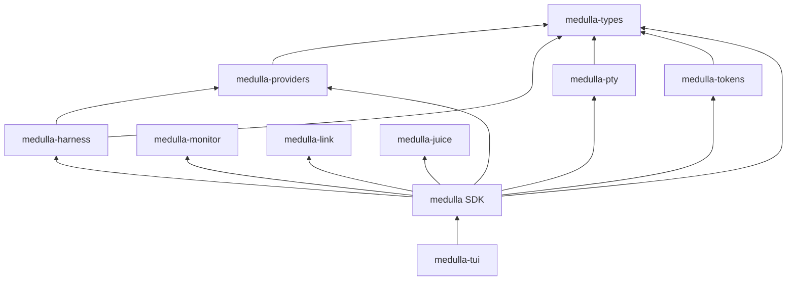

# One product, composable primitives

Medulla is one product made from focused Rust primitives. The terminal brings them together so you can run coding agents, see which sessions need attention, reach sessions on remote hosts, customize harness launches, and inspect usage from one place.

| Primitive | Crate | What it provides |
| --- | --- | --- |
| Multiplexer | `medulla-pty` and `medulla-tui` | PTY-backed sessions, a live screen for each, and one terminal interface for switching between them. |
| Monitor | `medulla-monitor` | Host resource sampling used to show machine state alongside sessions. |
| Link | `medulla-link` | State synchronization between a local client and remote host. |
| Compressor | `medulla-juice` | Optional context-compression integration for embedded turns. |
| Harness customizer | `medulla-harness` | Launch configuration and attribution helpers for coding-agent harnesses. |
| Provider registry | `medulla-providers` | Provider definitions and invocation shaping used by harness and routing paths. |
| Token stats | `medulla-tokens` | Token accounting and subscription meters. |

The SDK crate, published as `medulla` from `crates/medulla-core`, composes these primitives with configuration, sessions, the daemon, and application state. `medulla-tui` is the shipped terminal application and depends on the SDK. The small shared types crate keeps common values available without making primitives depend on the application.

The dependency direction keeps product primitives usable independently: no primitive depends on `medulla` or `medulla-tui`, and terminal rendering belongs to `medulla-tui`.

See [Architecture](../developers/architecture.md) for the full crate map and [One terminal, not a pile of them](../why-one-terminal.md) for the product rationale.
